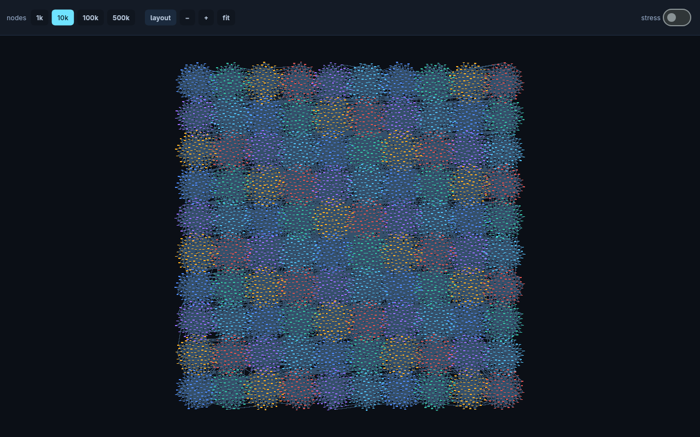
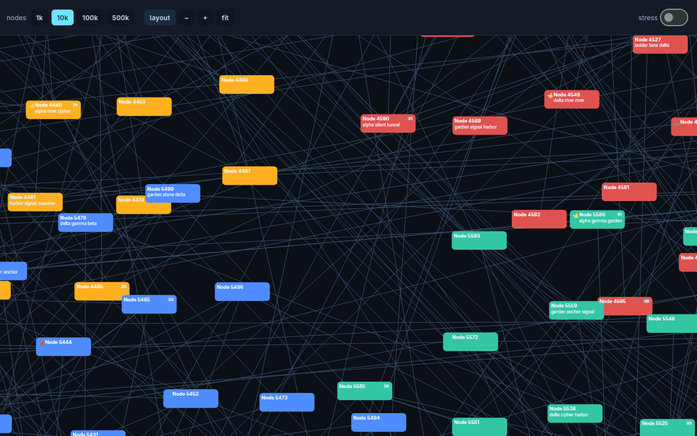
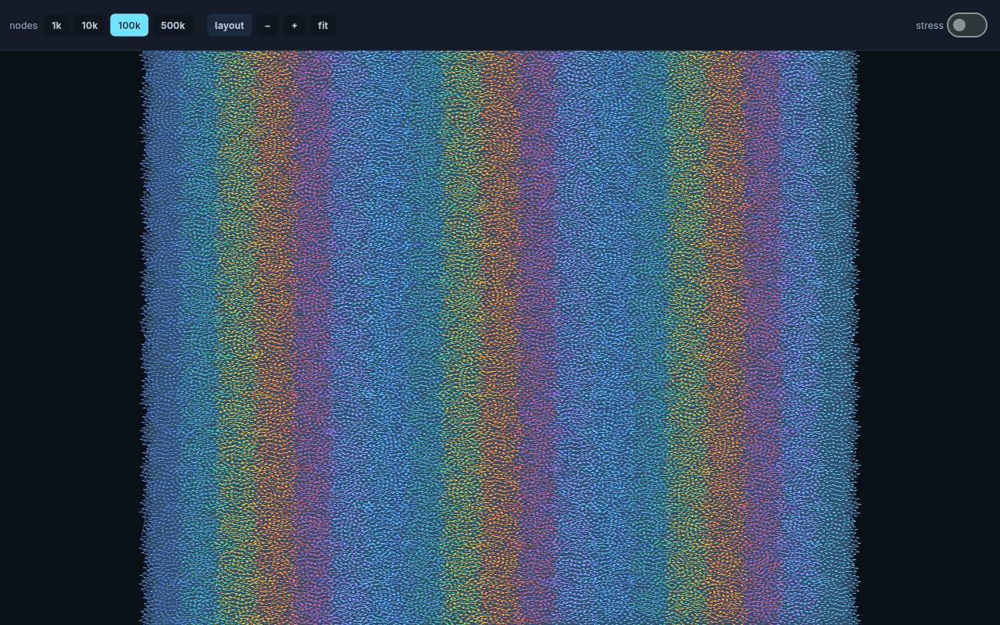
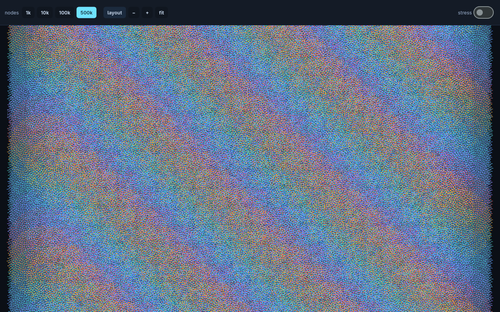
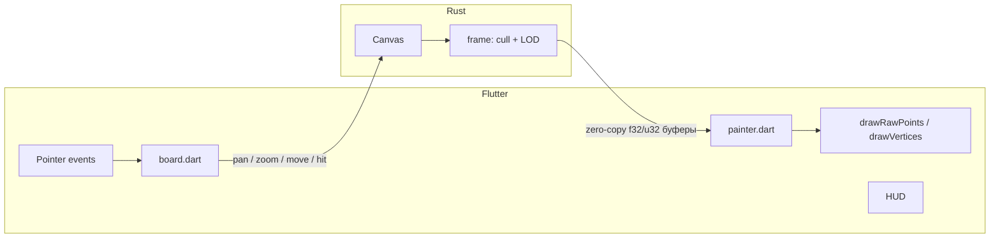

# canvas_rust

Графовый канвас «с нуля»: ядро на Rust, клиент на Flutter. Цель — держать
десятки тысяч узлов и связей интерактивными на слабых устройствах, где
дорог каждый кадр: и по CPU, и по числу GPU-вызовов.

## Как это выглядит



*10k нод / 14.5k связей, весь граф в кадре: 60 fps, 2 draw call.*



*Приближение: карточки с заголовком, строкой текста, бейджем и SVG-иконкой
(LOD отдаёт контент только для нод ≥92×34 px, ≤256 за кадр).*



*100k нод одним кадром: обзор запечён в текстуру, панорама — 1 draw call.*



*500k нод / 725k связей. Плотность такая, что граф превращается в текстуру —
и это 60 fps вместо 2.3 fps до кэша обзора. Скриншоты сняты
`flutter test --update-goldens` (HUD скрыт флагом `CANVAS_CLEAN_SHOTS`).*

```
canvas_rust/
├── core/              Rust: граф, индекс, culling, LOD, picking, layout, C ABI
│   ├── src/lib.rs     Canvas: frame() -> DrawList
│   ├── src/graph.rs   SoA-граф
│   ├── src/index.rs   uniform grid (CSR) для нод и рёбер
│   ├── src/draw.rs    culling + LOD + плоские буферы кадра
│   ├── src/hit.rs     picking
│   ├── src/layout.rs  Barnes–Hut
│   ├── src/demo.rs    детерминированный демо-граф
│   ├── src/ffi.rs     C ABI (без зависимостей, без кодогенерации)
│   └── src/bin/bench.rs
└── app/               Flutter: только ввод, GPU и текст
    ├── lib/src/native.dart   dart:ffi биндинги (ручные)
    ├── lib/src/painter.dart  CustomPainter: 2–14 draw call на кадр
    ├── lib/src/board.dart    жесты -> ядро
    └── test/                 FFI- и пиксельные тесты
```

## Разделение ответственности



- **Rust владеет данными и математикой**: граф, камера, пространственный индекс,
  отсечение, выбор LOD, picking, layout.
- **Flutter владеет пикселями**: шрифты, AA, GPU-батчинг Impeller/Skia. Рисовать
  растеризатором в Rust (tiny-skia) было бы медленнее на телефоне и добавило бы
  загрузку текстуры каждый кадр.
- Кадр пересекает FFI **один раз**: `cv_frame()` возвращает указатели и длины,
  Dart оборачивает их `asTypedList` (без копирования).

## Что именно оптимизировано

| Механика | Как |
|---|---|
| Хранение | SoA (`x, y, w, h, color, edges`), id = индекс, ни одной аллокации на ноду |
| Индекс | uniform grid, CSR через counting sort; ~1 ячейка на ноду |
| Мутации | drag ноды → dirty-список + её рёбра; полный rebuild только по порогу |
| Длинные рёбра | выносятся из сетки в линейный список, bbox-тест в один последовательный проход |
| Отсечение | быстрый путь «весь граф в кадре»: без обхода индекса, без stamp-массивов |
| LOD | ≤1200 видимых нод — `drawRRect` (сглаженно), иначе батч-треугольники; подписи ≤1200 нод, жёсткий кап 192 |
| Обзор 20k+ | граф один раз запекается в `ui.Image`, панорама = **1 textured quad**: на слабом GL это разница между 2 и 60 fps |
| Обход | если на экране больше половины графа — последовательный скан вместо индекса (без random-записи в stamp-массивы) |
| Контент нод | ядро отдаёт только id + экранный прямоугольник и **только** для нод ≥ 92×34 px, кап 256/кадр; текст раскладывается один раз на (нода, кегль, ширина) и переиспользуется при панораме |
| Рёбра | до ~600 оценённых видимых — сегменты (AA), выше — треугольники: Impeller тесселирует сегменты по ~2 мкс/шт; сегменты короче 2.5 px на экране не рисуются вообще |
| Буферы | переиспользуются между кадрами, запись через `spare_capacity_mut` (без memset) |
| Layout | Barnes–Hut на плоском квадродереве, 0.13 мс/итерация на 100k, чанками по 4 итерации с таймера |
| Picking | один проход по одной ячейке сетки, O(1) на клик |

## Протокол кадра

`cv_frame()` → `CvFrame { f32_ptr, f32_len, u32_ptr, u32_len, <секции...> }`.
Секции идут подряд без дырок, порядок фиксирован:

| Секция | Формат | Смысл |
|---|---|---|
| `edges` | 4 f32 (или 8 при `edges_quads=1`) | x1,y1,x2,y2 — или 4 угла quada |
| `rects` | 4 f32/нода | x,y,w,h в экранных пикселях |
| `quads` | 8 f32/нода | 4 угла, индексы строит Dart (общий буфер) |
| `labels` | 4 f32/подпись | прямоугольник под текст |
| `rect_colors` | u32/нода | ARGB |
| `quad_colors` | 4 u32/нода | ARGB на вершину |
| `label_ids` | u32/подпись | id ноды → текст берёт Dart |

Инвариант (проверяется тестом): секции покрывают оба буфера ровно, без
пересечений; все координаты конечны.

## Контент нод

Нода — это карточка: заголовок, строка текста, бейдж (и что угодно ещё, что
нарисует клиент). Ядро о контенте не знает: оно лишь решает, **каким нодам
вообще стоит его показывать**, и отдаёт список `id + экранный прямоугольник`.

Правила, которые держат кадр в бюджете:

- нода меньше 92×34 px на экране — контент не отдаётся (текст всё равно
  нечитаем), поэтому в обзоре 500k его нет вообще и блит-путь не затронут;
- не больше 256 нод с контентом за кадр (`LABEL_LIMIT` в `core/src/draw.rs`);
- раскладка текста кэшируется по `(id, кегль, ширина карточки)`, кегль
  квантован — панорама не вызывает ни одного `TextPainter.layout`;
- карточка стоит ≤4 draw call (заголовок, строка, бейдж, чип бейджа).

Замеры (плотная сетка, весь экран в карточках, 1280×800, этот софт-GL):

| режим | видимых нод | карточек | draw call | fps |
|---|---:|---:|---:|---:|
| без контента вообще | 612 | 0 | 613 | 60 |
| бюджет 256 | 612 | 256 | 869 | 60 |
| без бюджета | 612 | 612 | 1225 | 60 |

То есть текст — не узкое место: даже без капа 612 карточек укладываются в кадр,
а доминируют сами ноды (на этом LOD каждая — отдельный `drawRRect`). Кап 256
оставлен как запас на устройства слабее и на более тяжёлый контент (иконки,
изображения, прогресс-бары): при 4 draw call и площади карточки число карточек
физически ограничено площадью экрана.

### Иконки (SVG)

Правило зашито в `app/lib/src/icons.dart` и в API, а не в договорённостях:

- SVG растеризуется **ровно один раз** на пару `(ключ, пиксельный бакет)` в
  `ui.Image` и дальше только блитится (`drawImageRect`);
- **никогда** не парсить SVG и не строить/тесселировать `Path` внутри
  `paint()` — это превращает ~1 мкс блита в десятки микросекунд;
- промах кэша: кадр рисуется без иконки, слот в карточке уже зарезервирован
  (текст не «прыгает»), растер идёт асинхронно и по готовности просит один
  перерисовать;
- LRU на 128 изображений, вытесненные `dispose()`-ятся;
- цена: **+1 draw call на карточку**, карточек ≤256 за кадр (бюджет выше).

Тест `test/icons_test.dart` фиксирует контракт: второй кадр — попадание в кэш,
`rasterCount` не растёт, пиксели иконки появляются внутри карточки.

Если иконок станет много и они повторяются — следующий шаг тот же, что сработал
для обзора: сложить растеризованные иконки в атлас и рисовать всё одним
`drawAtlas` (0 draw call на карточку вместо 1).

## Ввод

| Жест | Действие |
|---|---|
| drag по пустому месту | панорама |
| drag по ноде | перенос ноды |
| колесо | зум к курсору |
| Ctrl/Cmd + колесо | зум (для тех, у кого скролл = панорама) |
| два пальца по тачпаду | панорама (мелкие дельты) |
| pinch на тачпаду (`PointerPanZoom*`) | зум + панорама |
| `−` / `+` / `fit` | зум от центра / вписать граф |

Тачпад отдаёт отдельный поток событий (`PointerPanZoom*`), а не колесо — без его
обработки зум на ноутбуке не работает вообще.

## C ABI

`cv_new/free/clear`, `cv_demo(n, seed)`, `cv_add_node`, `cv_add_edge`,
`cv_move_node`, `cv_select`, `cv_viewport`, `cv_pan`, `cv_zoom`, `cv_fit`,
`cv_view_scale/cx/cy`, `cv_set_camera`, `cv_node_x/y`, `cv_bounds_*`,
`cv_version` (для инвалидации запечённого обзора), `cv_frame`, `cv_hit`,
`cv_layout_step`, `cv_layout_reset`.

Указатели из `CvFrame` валидны до следующего `cv_frame`/мутации графа.

## Сборка и запуск

```bash
# ядро + тесты + бенчмарк
cargo test --release --manifest-path core/Cargo.toml
cargo run  --release --bin bench --manifest-path core/Cargo.toml

# клиент: CMake сам собирает cargo-часть и кладёт libcanvas_core.so в bundle
cd app && flutter run -d linux        # или: flutter build linux --release

# тесты клиента грузят core/target/release/libcanvas_core.so напрямую
cargo build --release --manifest-path core/Cargo.toml
cd app && flutter test
```

Другие платформы: `cdylib` тот же, для Android нужен
`cargo ndk -t arm64-v8a -o app/android/app/src/main/jniLibs build --release`
и `DynamicLibrary.open('libcanvas_core.so')` — путь уже входит в список
кандидатов загрузчика (`CANVAS_CORE_LIB` переопределяет всё).

## Цифры

Сборка draw-list (release, вьюпорт 1200×800, вся машина отдана под это):

| нод | рёбер | сборка графа | rebuild индекса | кадр (весь граф) | кадр (зум ×8) |
|---:|---:|---:|---:|---:|---:|
| 1 000 | 1 443 | 0.1 мс | 0.2 мс | 25 мкс | — |
| 10 000 | 14 464 | 0.6 мс | 1.7 мс | 252 мкс | — |
| 100 000 | 144 886 | 6.2 мс | 16.5 мс | 7.6 мс | 0.49 мс |
| 500 000 | 724 798 | 27.5 мс | 92 мс | 44 мс | — |

Picking: 0.3–1.9 мкс на запрос. Layout: 0.13 мс/итерация на 100k.

Сырой вывод последнего прогона (`docs/bench.txt`, машина шумная — числа плавают):

```
   nodes  edges  build_ms  index_ms  frame_us    hit_us    vis@fit    lod@fit
    1000   1443       0.2       0.6      87.7      1.82       1000          2
   10000  14464       1.2       4.1     498.0      1.89      10000          0
  100000 144886       7.0      17.4    3635.8      1.47      96415          0
  500000 724798      27.9      92.7   23346.6      1.89     389718          0
```

Живое приложение (release, Impeller, стресс-режим — камера непрерывно едет,
каждый кадр перерисовывается):

| сцена | fps | draw call | ядро, мс/кадр |
|---|---:|---:|---:|
| 10k нод / 14.5k рёбер | 60 | 2 | 0.7–0.95 |
| 100k нод / 145k рёбер, весь граф в кадре | 60 | 1 (блит обзора) | 0 (кадр не строится) |
| 500k нод / 725k рёбер, весь граф в кадре | 60 | 1 (блит обзора) | 0 |

До кэша обзора те же 500k давали **2.3 fps / 430 мс** кадр: 1.7 млн крошечных
треугольников на кадр. В этой VM GL фактически софтверный (~3 млн
треугольников/с), поэтому «рисовать меньше геометрии» — единственный путь;
на реальном мобильном GPU такие графы упираются уже в другие пределы.

Цена: первый кадр после загрузки/зума рисуется «живьём» и один раз запекается
(~0.5–1 с на 500k), дальше панорама бесплатна до смены данных или зума >~25%.
На телефоне с нормальным GPU стоимость растеризации другая, а вклад ядра
остаётся тем же — его и надо держать в бюджете кадра.

## Тесты

Сырой вывод: [`docs/tests.txt`](docs/tests.txt). Кратко: **17 Rust + 21 Dart,
0 падений, `flutter analyze` — 0 ошибок** (только info о deprecation
`material.dart` в самом SDK).

- Rust (17): сверка сетки с брутфорсом на случайных графах, поведение после
  drag без rebuild, инварианты секций буфера, LOD-переключения, устойчивость
  layout, отсутствие роста буферов.
- Dart (19): FFI-контракт, зум/пан/хит-тест/выбор, сходимость layout,
  **жесты** (drag, колесо, тачпад-панорама/пинч, перенос ноды), переключение на
  запечённый обзор, **пиксельные** тесты через `Picture.toImage` — цвет каждой
  ноды, батч-треугольники, AA-рёбра, подписи поверх нод.

## Ограничения и следующие шаги

- Текст подписей живёт в Dart (`TextPainter` с кэшем): ядро отдаёт только
  прямоугольник и id, максимум 192 подписи за кадр.
- Все рёбра одного цвета: `drawVertices` без вершинных цветов экономит 16 Б
  на ребро, а раскраска рёбер в графовых редакторах нужна редко.
- Массовый LOD рёбер рисуется без AA (2 треугольника на ребро). При желании —
  полосатая текстура или MSAA-таргет.
- Layout идёт на главном потоке чанками (~0.5 мс за тик): это осознанный выбор
  против гонок при чтении позиций из другого изолята.
- Кэш обзора живёт до первого изменения данных: перетаскивание ноды или layout
  инвалидируют его, и следующий кадр снова рисуется «живьём» (пока не
  запечётся заново). Для 500k это заметный, но разовый провал.
- Запекание — один тяжёлый кадр; при желании его можно вынести в отдельный
  isolate с копией графа.
- Дальше: «loose grid» (1 ячейка на ноду без dedupe) — самый крупный
  оставшийся выигрыш на графах 500k+, и rebuild индекса в фоне.